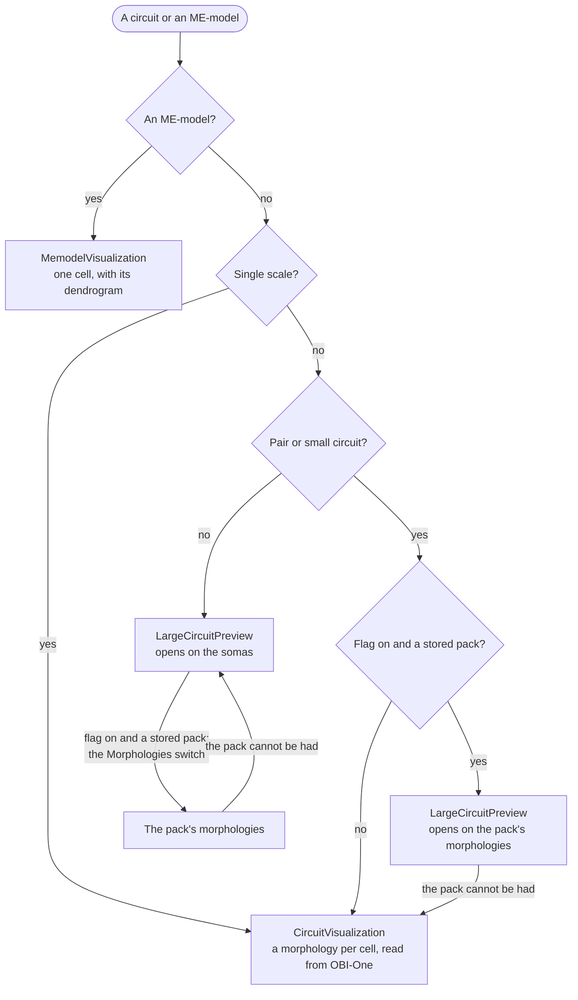
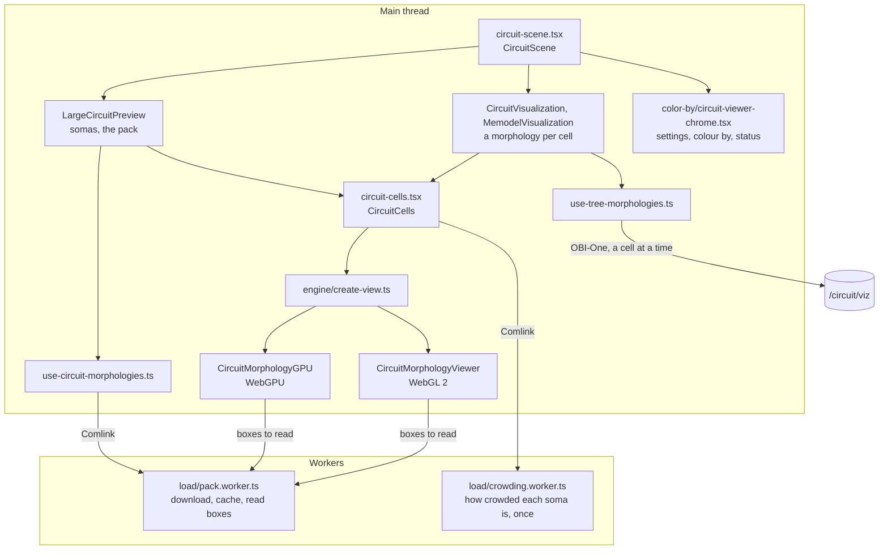
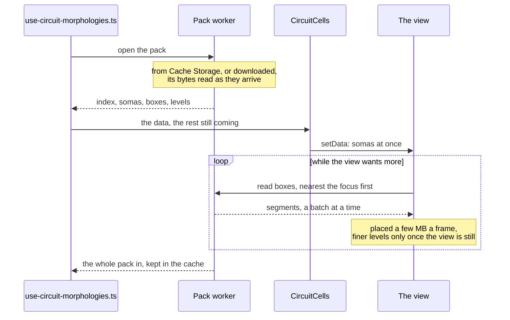

# Circuit viewer

The 3D view of a circuit, a simulation's spikes over it and the electrodes placed in it: in a simulation's setup, on an extracellular recording array's page and in the spike replay. One three.js engine draws every circuit, from a single cell to a whole brain, with WebGPU where the browser has it and WebGL 2 otherwise. This page is the overview: which circuit is drawn how, what runs where, the status and settings, and where to change what. Two pages go deeper:

- [morphologies/load/README.md](morphologies/load/README.md): how the morphologies are read, from OBI-One's pack or a cell at a time.
- [morphologies/engine/README.md](morphologies/engine/README.md): how they are drawn: the two tiers, the level of detail, the culling, the shading.

In short:

- A circuit shows first as its somas, one per cell, coloured by the property chosen. Its morphologies come from its morphology pack: one file OBI-One writes for each circuit, with the morphologies simplified at three levels, placed and cut into boxes of space. The viewer reads the coarsest level first, then finer levels box by box where the view needs them.
- WebGPU culls on the GPU what is hidden and draws up to 4M segments finer than the coarsest level, which it keeps drawn where it fits. WebGL 2 draws up to 2M segments, chosen by what is in the frame and how large it is on screen. Where the morphologies in view come to more than that, their somas are drawn instead, and the status says to zoom in.
- A single cell, and a pair or small circuit without a pack, are drawn a morphology per cell, read from OBI-One one cell at a time, with section ids for picking a location.
- The morphologies are behind the `circuit-morphologies` flag (`circuitMorphologiesFlag`), off by default, offered in local, preview and staging. Without it, circuits above small scale are drawn as somas only.

Measured on an M4 Pro in Chrome, with WebGPU:

| Circuit | Drawn | Browser at most | GPU process at most | Date |
| --- | --- | --- | --- | --- |
| A tenth of the fly brain, 13,790 cells | Zoomed to 8× and back, none left out; settled in 0.4 to 0.7 s | not taken | 1,637 MB | 2026-10-17 |
| The whole fly brain, 137,900 cells | The coarsest level, 18.6M segments; a moving frame 13 to 14 ms | 4,078 MB | 2,243 MB | 2026-10-17 |

The packs' sizes, and how long they take to build, are in OBI-One's `obi_one/scientific/library/morphology_pack/docs/performance.md`.

## Which circuit is drawn how

- `circuitDrawsEachCell` ([draws-morphologies.ts](../scan-config/components/circuit-viz/sources/draws-morphologies.ts)) answers for every caller, so that they cannot disagree. The cutoff is cost: a morphology per cell reads every point of every one, far too many from a microcircuit up. A single cell stays on it whatever the flag, because picking a location on it needs section ids, which the pack does not carry.
- A circuit has a pack where `storedPackOf` finds an asset labelled `circuit_morphology_pack`, created and not a directory.
- A pair or small circuit whose pack fails is drawn a cell at a time instead, for as long as it is on show (`fellBackFor` in [circuit-scene.tsx](circuit-scene.tsx)). A larger one goes back to its somas, and the status offers Try again.

## Where it is mounted

| Host | Through | What it sets |
| --- | --- | --- |
| A simulation's setup, right column | [ui-columns/right.tsx](../scan-config/components/ui-columns/right.tsx), `ModelPreview`, `CircuitPreview` | The form, read-only while the setup is locked; electrodes, location picking where the circuit allows |
| An extracellular recording array's page | [detail-view.tsx](../entities/extracellular-recording-array/detail-view.tsx), `ModelPreview` | Its electrodes, which the page shows and hides; neurons at 20 % opacity; no form |
| A circuit's Overview | [detail-view.tsx](../entities/circuit/detail-view.tsx), `CircuitPreview` | Nothing more: always a morphology per cell |
| The spike replay | [spike-replay-view.tsx](../spike-viewer/spike-replay/spike-replay-view.tsx) | The spikes, one population pinned and the others not drawn; its own pill and fullscreen |

`ModelPreview` ([model-preview/index.tsx](../scan-config/components/model-preview/index.tsx)) picks the ME-model, small and large features by the same predicate. `CircuitPreview` ([circuit-preview.tsx](../scan-config/components/model-preview/circuit-preview.tsx)) adds the pill between the 3D view, the circuit's image and an ME-model's dendrogram, each kept mounted while hidden.

## From the host to the GPU

- `CircuitScene` ([circuit-scene.tsx](circuit-scene.tsx)) is mounted by every host. It holds the nodes table, the population on show and the fallback, and lays the chrome over the view.
- `useCircuitColorBy` ([use-circuit-color-by.ts](../scan-config/components/color-by/use-circuit-color-by.ts)) holds what the user chose (`useViewerConfig`, in memory for the page's life) and builds the menus. `usePlacedScene` ([use-placed-scene.ts](../scan-config/components/model-preview/use-placed-scene.ts)) places every population, in the order declared, so that choosing another one only recolours.
- `CircuitCells` ([circuit-cells.tsx](morphologies/circuit-cells.tsx)) makes the view, pushes each prop into it as it changes, in a fixed order, and wires the pointer and the electrodes. A view whose WebGPU gives out is made again, with WebGL 2.
- The chrome reaches the view through signals ([signals.ts](signals.ts)): re-centre, snapshot, zoom and the nudge that shows where a location is. Each has one handler, the last registered.

## A load from the pack

A box can be read at a level as soon as its bytes and its bases' are in, so the view fills while the rest downloads. The steps are in [morphologies/load/README.md](morphologies/load/README.md#how-it-works), and which level each box gets in [morphologies/engine/README.md](morphologies/engine/README.md#detail).

## Status and notices

The morphologies' pill sits beside re-centre ([load-status.tsx](morphologies/load-status.tsx)). It shows the first of these that applies:

| When | What shows |
| --- | --- |
| The pack is loading | "Loading morphologies… 4.1 / 8.0 MB" |
| It failed, or the rest of it did not come in | "The morphologies could not be loaded", or "Not all of the morphologies could be loaded", with Try again and Dismiss. What is drawn stays. |
| The morphologies in view are over the budget | "Too many morphologies in view: zoom in to see them"; where the browser has no WebGPU, adding "A browser with WebGPU shows them all" |
| WebGPU gave out | "Drawn with WebGL 2 after the graphics were reset", or "…: the graphics ran out of memory", with Dismiss |
| The rest of the pack is still coming | Its progress, as while loading |

Elsewhere:

- The populations' checklist warns when the selected population is hidden ("Show") or every one is ("Show all").
- A circuit drawn a morphology per cell shows "Couldn't load the visualization", with Try again where the source itself did not fail. While it loads, a veil counts the nodes downloaded and the morphologies drawn, after 300 ms ([visualization-loading-indicator.tsx](../scan-config/components/shared/visualization-loading-indicator.tsx)).
## Settings and debug mode

The settings menu ([viewer-controls-menu.tsx](../scan-config/components/color-by/viewer-controls-menu.tsx)) shows the rows its host passes:

- capture image;
- Morphologies, where there is a pack;
- axons;
- electrodes and their size;
- spin;
- scale bar;
- zoom slider;
- location labels and their size;
- with the somas alone, neuron opacity and soma size, 0.2 to 2 times the species' radius (`SOMA_RADII`: rat 15 µm, mouse 12, fly 4);
- the background, light or dark.

The defaults are `DEFAULT_VIEWER_CONFIG` ([use-viewer-config.ts](../scan-config/components/color-by/use-viewer-config.ts)). Axons start shown on circuits above small scale and hidden on pair and small ones. There is one look, Studio (`createLooks` in [looks.ts](../viewer-3d/engine/looks.ts)).

Debug mode is not a flag. It is the `localStorage` key `@openbraininstitute/morphoviewer:debug` ([debug-mode.ts](debug-mode.ts)), shared with the morphology viewer, and it turns on:

- the readout under the view ([detail-readout.tsx](morphologies/detail-readout.tsx)): the segments drawn and wanted, the budget taken, the boxes by level, the floor, what the culling drew, and why a tier was chosen;
- selects for the budget, the tolerance in pixels, the culling and the renderer (Auto or WebGL 2), to compare on a machine;
- a download of the nodes as JSON, and the synapses' diagnostics.

## Interaction

- **Hover and click.** The cell under the pointer is read from the GPU, one read at a time, every 60 ms at most, none while the view moves ([pointer.ts](morphologies/pointer.ts)). A press that moves under 4 px is a click. Clicking a cell of another population selects that population.
- **Locations on a morphology** (a single cell or an ME-model): [use-location-selection.ts](../scan-config/components/circuit-viz/morphology-location/use-location-selection.ts) adds a location where a dendrite is clicked and removes one where its marker is. It refuses, with a message, a section that is not a dendrite, a cell of another population, another block's marker and the last location of a block. The section and offset come from the segment picked, which only a morphology read per cell knows.
- **Electrodes** ([electrodes.ts](morphologies/electrodes.ts)): a drag moves the array on the plane facing the eye. Alt, Shift or the right button turns it. On release it holds its place until the form agrees, or for 2 s.
- **Synapses**, on a single cell: read from the circuit's edge files ([use-afferent-synapses.ts](../scan-config/components/circuit-viz/sources/use-afferent-synapses.ts)), projected onto the surface of the morphology as drawn, and coloured by type.
- **Spikes.** `SpikeClock` ([spike-clock.ts](spike-clock.ts)) is advanced by the view at each frame it draws, by the wall clock times the speed. A frame steps at most 250 ms, and never past the glow's window, 5 afterglows, so that no spike is skipped. Each cell glows by its latest spike, falling by e every afterglow. The replay's page reads the time back every 100 ms, which keeps React out of the frame. How a spike lights a cell is in [the engine's reference](morphologies/engine/README.md#picking-cells-and-spikes).

## Where to change what

| To change | Look in |
| --- | --- |
| Which circuits are drawn how | `circuitDrawsEachCell` in [draws-morphologies.ts](../scan-config/components/circuit-viz/sources/draws-morphologies.ts) |
| The budgets and the tolerance in pixels | `SEGMENT_BUDGET` and `DETAIL_PIXELS` in [engine/detail.ts](morphologies/engine/detail.ts); the Debug choices in [detail-readout.tsx](morphologies/detail-readout.tsx) |
| When WebGPU is used | [engine/create-view.ts](morphologies/engine/create-view.ts), [engine/probe.ts](morphologies/engine/probe.ts) |
| The pack's cache | `STORED_PACK_CACHE` in [load/worker-api.ts](morphologies/load/worker-api.ts), made by `bucket` in [asset-cache.ts](../viewer-3d/load/asset-cache.ts) |
| Status texts | [load-status.tsx](morphologies/load-status.tsx) |
| Settings, their defaults and the menu | [use-viewer-config.ts](../scan-config/components/color-by/use-viewer-config.ts), [viewer-controls-menu.tsx](../scan-config/components/color-by/viewer-controls-menu.tsx) |
| Soma radius by species | `SOMA_RADII` in [hooks.ts](../scan-config/components/model-preview/large-circuit-preview/hooks.ts) |
| The look and its exposure | `createLooks` and `EXPOSURE` in [viewer-3d/engine/looks.ts](../viewer-3d/engine/looks.ts) |
| Spike timing | [spike-clock.ts](spike-clock.ts); the band along the fibres in [engine/spike-light.ts](morphologies/engine/spike-light.ts) |
| How electrodes move and turn | `TURN_PER_PX`, `HOLD_MS` in [electrodes.ts](morphologies/electrodes.ts) |
| Hover and click | `LOOK_MS`, `CLICK_REACH` in [pointer.ts](morphologies/pointer.ts); `PICK_REACH` in [engine/circuit-view.ts](morphologies/engine/circuit-view.ts) |

## Tests

- `src/__tests__/circuit-viewer/`: the scene's fallback from the pack, the signals, the spike clock.
- `src/__tests__/circuit-morphologies/`:
  - the loader and the pack reader, on packs OBI-One wrote (`fixtures/`);
  - the detail, the stream and the arena, with a fuzz run of random views;
  - the tiers, with a fake GPU (`fake-gpu.ts`), and the culling's lists;
  - the WebGL 2 view end to end in jsdom;
  - `CircuitCells`, the pointer and the electrodes.
- `src/__tests__/scan-config/`: which circuit is drawn how, the large preview's pill and fallbacks, the small and ME-model sources, location picking, the settings menu.
- `src/__tests__/viewer-3d/`: the scale bar, the status pill and the cache bucket.

## Glossary

The pack's own terms (segment, level, base, box, reach) are in OBI-One's `obi_one/scientific/library/morphology_pack/docs/README.md`. The viewer adds:

| Term | Meaning |
| --- | --- |
| Tier | WebGPU or WebGL 2: which of the two engines draws a view. |
| Budget | The most segments a view draws at once, in blocks of 64; on WebGPU, those finer than the coarsest level. |
| Floor | The finest level at which the whole pack fits the budget. Every box is drawn at least at it, in view or not. |
| Arena | The GPU buffers that hold the segments drawn, a box after another. |
| Hole | Room in the arena left by a box taken out, which another box can take. |
| Seen box | A box the culling found any segment of on screen, of late. Only those go finer. |
| Kept list | The segments the culling found seen or just hidden, drawn first to depth in the next frame to test against. |
| Cloud | The somas drawn alone, as low pyramids or flat quads. |
| Piece | A share of the cloud, near somas together, which three culls by its bounds. |
