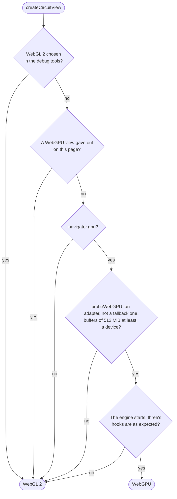
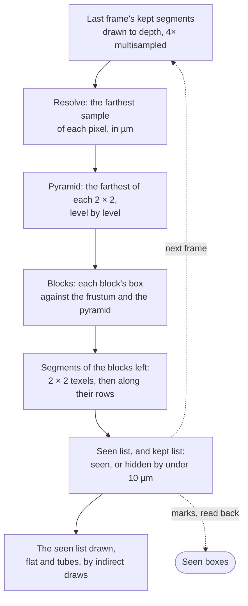

# Circuit morphology engine

Draws a circuit's cells: its somas, its morphologies over them, a pack's boxes at the levels the view needs, the spikes and the electrodes. The in-depth reference: how each part works, and why it is done that way. For the overview (which circuit is drawn how, the hosts, the status and where to change what) see [../../README.md](../../README.md). How the morphologies are read is in [../load/README.md](../load/README.md).

Positions are in µm around the circuit's centre, which the view orbits. Timings are on an M4 Pro in Chrome.

## Two tiers

`CircuitView` ([circuit-view.ts](circuit-view.ts)) holds everything both tiers share: the data, the cell table, the detail, the stream, the pick, the spikes and the dots. A tier adds its renderer and its materials:

- `CircuitMorphologyGPU` ([webgpu/circuit-morphology-gpu.ts](webgpu/circuit-morphology-gpu.ts)): three's WebGPU renderer, with the culling, the ambient occlusion and the spikes' bloom of its own.
- `CircuitMorphologyViewer` ([circuit-morphology-viewer.ts](circuit-morphology-viewer.ts)): WebGL 2, straight onto the antialiased canvas.

Both are a `SceneView` ([viewer-3d/engine/scene-view.ts](../../../viewer-3d/engine/scene-view.ts)): the cameras, the controls, the glide and the render-on-demand loop the morphology and EM viewers share.



- The WebGPU engine's module is fetched while the device is asked for ([create-view.ts](create-view.ts)). The device is asked with every feature the adapter has, and buffers up to 2 GiB ([probe.ts](probe.ts)).
- The engine reaches into a few of three's private parts, all in [webgpu/three-hooks.ts](webgpu/three-hooks.ts): the GPU object behind each of three's (`backend.get`), to bind buffers of its own; the timestamps of a frame; three's own loop. `checkHooks` checks the one the engine cannot do without, `backend.get`, once the renderer is ready. A release of three without it is `Unfit`, and the view is drawn with WebGL 2 rather than broken.

Once drawing, a WebGPU view can give out:

| What | Then |
| --- | --- |
| The device is lost | `onLost`: the view is made again with WebGL 2, as is every view made after on the page. The status says so. |
| The arena's buffers are out of memory | The arena is made again without its base, on the same device. Where there was no base to drop, or that fails too, as for a lost device. |
| The culling cannot run | Every box in view counts as seen, and every segment is drawn |
| The somas' culling cannot run | The cloud is drawn by pieces, as on WebGL 2 |
| The ambient occlusion cannot run | Frames are drawn without it; where only the glow failed, without the glow |

## Detail

A pack holds three levels; each box of space is drawn at one of them, or not at all. `chooseDetail` ([detail.ts](detail.ts)) chooses, box by box:

1. The box, grown by a quarter of its side (`REACH`), as a box holds segments whose far end it holds, is tested against the frustum.
2. In view, the µm a device pixel spans where the box comes nearest the eye picks the coarsest level whose tolerance is within 2 of them (`DETAIL_PIXELS`).
3. **The floor** (`DetailRules.wholeFloor`): the finest level at which every box of the pack fits the budget. Every box is drawn at least at it, in view or not, so that a small circuit is drawn finest whatever the view, and turning it reads nothing. A circuit whose finer levels are all over the budget has no floor.
4. Of a pack still coming in, a box is wanted no finer than its bytes in allow (`readableAt`).
5. **The budget.** Over it, boxes go coarser a level at a time, those farthest from what the view turns about first. Still over it at the coarsest, every box in view is left out: their somas are drawn, and the status says to zoom in. The budget counts segments in blocks of 64, as the arena holds them, and on WebGPU only those finer than the base, which is always drawn.

The budgets are 4M segments on WebGPU and 2M on WebGL 2 (`SEGMENT_BUDGET`). `chooseDetail` runs before a frame where the camera, the view's size, the rules, the motion, the seen boxes or the bytes in have changed, in `beforeDraw` rather than with the frame's other work, as the near and far planes are set by then.

On WebGPU with a base, a box in view may go finer than its base only while the culling sees it (*Seen boxes*).

## The stream

`DetailStream` ([detail-stream.ts](detail-stream.ts)) brings the arena to what the view wants:

- **Reads.** One batch in flight, of at most 250,000 segments, from the pack's worker. The bases of the boxes in view first, then the finer levels wanted, nearest the focus first, then the other bases. A box that fails to read is left out, and not asked for again.
- **Finer only at rest.** While the view moves, nothing finer is read, and with a base nothing at all: a turn draws what is there.
- **Coarser at once.** A box wanted coarser goes back to its base, or out, with no read. A box wanted at the floor keeps what it has until its level is read.
- **Placing** is paced to 4 MB of upload a turn of the loop, those that make room first, so that a frame stays short.

### Seen boxes

With a base, the culling marks the blocks it found seen or just hidden, and the marks are read back a frame or two late (`see`).

- A box marked within the last 30 reads is seen while the view moves. At rest, within the last 4 reads of frames drawn at rest (`LINGER`).
- A box not seen keeps the level it has while the view rests, finer or coarser, so that no frame at rest takes away what it hides.
- As the view moves, a box not seen goes back to its base. One let go of at rest is not asked for again until the view moves or the rules change.

## The arena

`SegmentArena` ([segment-arena.ts](segment-arena.ts)) holds the segments drawn, 36 bytes each: the two ends with their radii, and a word of cell and section type.

- A box's segments start a block of 64 and its last block is padded with holes. Each block keeps the box round its segments, which the culling tests.
- A box taken out leaves a hole: its words are marked `HOLE`, which the shaders draw nothing of, and its blocks are emptied. Only those words are uploaded.
- A box goes into the smallest hole it fits, or at the end. Where neither has room, every box is moved down to close the holes. The arena has room for the most the budget allows and a quarter more, so that this is seldom needed.
- Only what lies before the end is drawn and uploaded.

**The base.** On WebGPU, where the coarsest level of every box fits one storage binding, the arena starts with room for each box at it, in box order, never moved. A box put at a finer level has its base made holes in the same upload, and its base shown again when it is taken out. So every draw of the arena draws each box once. The culling's depth prepass, which draws last frame's kept segments, never tests against geometry the frame does not draw, with no second copy of the arena to swap between.

On WebGL 2 the arena is three's instanced attributes, uploaded by range. On WebGPU it is buffers the engine owns and three binds (`shareBuffer` in [webgpu/three-hooks.ts](webgpu/three-hooks.ts)), uploaded with `writeBuffer` and drawn by indirect draws from the culling's lists ([webgpu/arena-gpu.ts](webgpu/arena-gpu.ts)).

## Culling, on WebGPU

A frame:



- One compute pass does it all ([webgpu/culling.ts](webgpu/culling.ts), [webgpu/culling-wgsl.ts](webgpu/culling-wgsl.ts)): one workgroup a block, one thread a segment.
- The occluders are last frame's kept segments, not this frame's drawn twice. A segment hidden by up to 10 µm (`KEEP_UM`) is kept too: as the view moves, what was seen parts in thin cracks, and with nothing behind them every block would show through one.
- The lists are as long as the arena, so no frame overfills them. The counts, the draws' arguments and the marks are read back from a pool of 8 buffers. Where none is free, the last test is read once one is, so that the last before the view rests always is. A read of an arena since replaced is dropped.
- **Somas** are culled the same way, one thread a soma tested as a sphere, where they are drawn opaque and alone ([webgpu/soma-culling.ts](webgpu/soma-culling.ts)). After a jump of the view, the first test draws the cloud's pieces to depth instead of the somas kept: those kept for another view hide little in this one, nearly every soma would be seen, and the driver would hold hundreds of MB more until the view rests.

WebGL 2 has no culling of its own: three culls the cloud's pieces by their bounds, and the detail is chosen by frustum and pixels alone.

## Somas

The cloud ([soma-cloud.ts](soma-cloud.ts)) draws a soma as a low hexagonal pyramid shaded as a sphere, or as a flat quad once under 3 px across (back to pyramids over 3.6 px).

- It is cut into pieces of nearby somas in Morton order, at most 512 pieces, so that three culls those out of view and draws the near ones first.
- Translucent, it is drawn whole, in the page's order, so that blending does not follow the pieces.

With morphologies, each soma is a quad ray-cast as a sphere ([impostors.ts](impostors.ts)).

## Segments and shading

- **Segments** are one quad each. On WebGL 2 a quad is shaded as a cylinder across its width at one depth, the tube's nearest.
- On WebGPU, a segment wider on screen than 48 device pixels is ray-cast as a rounded cone that meets the next in a round joint, writing its own depth (`TUBE_FROM_PX` in [webgpu/gpu-uniforms.ts](webgpu/gpu-uniforms.ts)). From 12 px, CA1's 300 cells took 15 ms more a frame zoomed 16 times in; from 48 px, 2.6 ms. A tube discards what lies behind the farthest depth before the tests, so that it is not shaded under what covers it.
- **The look** is the morphology viewer's Studio ([looks.ts](../../../viewer-3d/engine/looks.ts)). On WebGPU the materials are three's node materials, tone mapped as on WebGL 2.
- **Ambient occlusion**, on WebGPU at rest ([webgpu/occlusion-gpu.ts](webgpu/occlusion-gpu.ts)): GTAO at half resolution, from a surface target the cells write beside their colour.
  - Its depth is linear, in two 16-bit halves: the depth buffer's own steps were about 2 µm a millimetre away, which banded a far sphere.
  - Moving frames leave it out, but keep their resolution: they are drawn through targets of the canvas's size, which a cut in resolution would make again.

## Picking, cells and spikes

- **Pick** (`numberAround` in [circuit-view.ts](circuit-view.ts)): the cells are drawn as ids, `cell + 1` across a pixel's bytes, into a small target round the pointer, and read back asynchronously; the id nearest the middle wins. Of morphologies read a cell at a time, the same read gives the segment, so the section and its offset.
- **The cell table** ([cell-table.ts](cell-table.ts)): a texel a cell, in rows of 2,048, the widest texture WebGL 2 promises. Its colour, or none for hidden, or by section; a glow texture rewritten each frame of a replay for the cells lit; the crowding. A segment's word keeps the cell in 24 bits (`CELL_MASK`), so a view takes 16.7M cells at most.
- **Spikes** ([spike-light.ts](spike-light.ts)): the time since a cell's last spike is read back from its glow, which falls by e every afterglow. From it, a band runs out from the soma along the fibres at 400 µm a second of the wall clock, the whole cell kept a quarter lit behind it. In the cloud, a soma swells and is drawn opaque. On WebGL 2 the band is always drawn on the morphologies. On WebGPU it is drawn while the transport's Glow switch is on, with a bloom and a line drawn through the cells in front of a lit one.
- **Electrodes, synapses and markers** ([electrodes.ts](electrodes.ts)): discs with a ring, drawn over the cells; synapses depth-tested among them. Their hits are tested on the page, not on the GPU.

## Settings

| Name | Where | Value | What it sets |
| --- | --- | --- | --- |
| `SEGMENT_BUDGET` | `detail.ts` | WebGPU 4M (finer than the base), WebGL 2 2M | The most segments drawn at once |
| `DETAIL_PIXELS` | `detail.ts` | 2 | The device pixels a level's tolerance may span |
| `BATCH_SEGMENTS` | `detail-stream.ts` | 250,000 | The most segments asked of the worker at once |
| `PLACED_SEGMENTS` | `detail-stream.ts` | 4 MiB of them | Placed in a turn of the loop |
| `LINGER` | `detail-stream.ts` | 30 reads moving, 4 at rest | How long a box counts as seen |
| `BLOCK` | `segment-arena.ts` | 64 | Segments a block, as culled and as the budget counts |
| `LEAST_BUFFER`, `MOST_BUFFER` | `probe.ts` | 512 MiB, 2 GiB | The least binding WebGPU must give, the most asked for |
| `KEEP_UM` | `webgpu/culling-wgsl.ts` | 10 µm | How far behind what hides it a segment is kept, to hide others |
| `BLOCK_TEXELS`, `ROWS` | `webgpu/culling-wgsl.ts` | 8, 4 | Where a test moves to a coarser level of the pyramid |
| `TUBE_FROM_PX` | `webgpu/gpu-uniforms.ts` | 48 | From how wide a segment is a tube |
| `AO_SCALE`, `AO_RADIUS_CSS`, `AO_SAMPLES` | `webgpu/occlusion-gpu.ts` | 0.5, 32, 16 | The occlusion's resolution, reach and samples |
| `QUADS_BELOW_PX`, `PYRAMIDS_ABOVE_PX` | `soma-cloud.ts` | 3, 3.6 | When a soma is a quad |
| `PULSE_UM_PER_S` | `spike-light.ts` | 400 | How fast a spike runs out from the soma |
| `MIN_RADIUS` | `impostors.ts` | 0.75 device px | The least radius a fibre is drawn with, so that a thin one far away is not left in dashes |

## Limitations

- No test runs a real WebGPU device. The tiers' logic runs on a fake one (`fake-gpu.ts`), and the arena drawn the WebGPU way runs on the WebGL 2 view.
- Zoomed in on the largest circuits, the GPU process holds over 2 GB at rest, which the driver keeps rather than the engine.
- With a base, the base is read before the finer levels, even where the floor will draw every box finer.
- On WebGL 2 the budget draws the whole fly brain, whose coarsest level is 18.6M segments, as somas alone.
- A soma is a sphere: the soma's traced outline is not drawn.

## Considered, and left out

- **Simplifying in the browser.** The levels are made once by OBI-One, where the browser would make them at each visit.
- **Two copies of the arena, swapped between frames,** so that the prepass never reads a box at two levels. The base hidden in the same upload already ensures that.
- **Sorting the segments by Morton order in OBI-One's writer.** A run's points are coded one from the last, so another order is another format; the worker sorts each box as it reads it instead.

## Layout

```
circuit-view.ts            CircuitView: what both tiers share, the frame's work, pick, spikes, dots
create-view.ts             which tier draws a view, and WebGL 2 for the page once WebGPU gave out
probe.ts                   the WebGPU adapter and device, or why not
circuit-morphology-viewer.ts   the WebGL 2 tier
detail.ts                  the level each box is drawn at, the floor, the budget
detail-stream.ts           the boxes read, placed and let go of; seen boxes
segment-arena.ts           the segments drawn, in blocks with holes, the base
impostors.ts               segments and somas as quads, on the Studio look; the pick
soma-cloud.ts              the somas alone, in pieces
cell-table.ts              a texel a cell: colour, glow, crowding
spike-light.ts             how a spike lights a cell
electrodes.ts              electrodes, synapses and markers as discs
webgpu/
  circuit-morphology-gpu.ts   the WebGPU tier: the frame, its fallbacks, the timing
  arena-gpu.ts             the arena's buffers, shared with three
  culling.ts, culling-wgsl.ts   the culling and its read-back
  depth-pyramid.ts         the depth prepass's target and the pyramid
  soma-culling.ts          the somas' culling
  impostors-gpu.ts         segments, tubes and somas as node materials; the line through
  soma-cloud-gpu.ts, dots-gpu.ts, cells-wgsl.ts   the cloud, the dots, the cell table, in WGSL
  occlusion-gpu.ts         the ambient occlusion and the glow
  gpu-uniforms.ts          the uniforms the nodes read
  three-hooks.ts           what the engine reaches into three for
  error-scope.ts, usage.ts helpers
```

Tests: `src/__tests__/circuit-morphologies/`: the tiers (`create-view.test.ts`), the WebGL 2 view end to end (`circuit-morphology-viewer.test.ts`), the detail, the stream and the arena, with a fuzz run of random views (`detail-stream-fuzz.test.ts`), the culling's lists and read-back, the somas' culling, three's hooks, the impostors, the cloud and the cell table.
