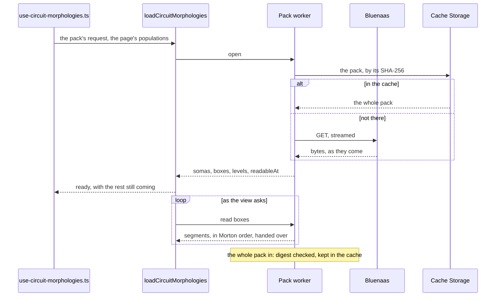

# Circuit morphologies: loading

How the circuit viewer gets its morphologies. A circuit's pack is read in a worker, its somas at once and its boxes as the view asks for them. A morphology per cell is read from OBI-One on the main thread. Both hand the engine a `CircuitMorphologyData` ([../types.ts](../types.ts)). Which circuit takes which path is in [the overview](../../README.md#which-circuit-is-drawn-how), and what the engine does with the boxes in [the engine's reference](../engine/README.md).

The pack's format is specified in Bluenaas's `app/core/morphology_pack/docs/format.md`. What this reader relies on beyond the specification, and so what a change to the writer can break, is in `reader-contract.md` beside it.

## The pack



### How it works

1. **The request.** The host hands over the pack's size and SHA-256 from Bluenaas's answer (`useMorphologyPackStatus`). `packRequest` ([../use-circuit-morphologies.ts](../use-circuit-morphologies.ts)) adds Bluenaas's URL for the pack's bytes, `GET /circuit/{id}/morphology-pack`, with the page's token and project (`buildMorphologyPackDownloadRequest`). The hook starts the load in a `setTimeout`, so that React's StrictMode, which runs an effect twice, does not start a download only to abort it.
2. **One worker a load.** `loadCircuitMorphologies` ([load.ts](load.ts)) starts [pack.worker.ts](pack.worker.ts) and keeps it until the load is aborted or fails. Aborting terminates it, which stops the download. Each call to it is raced on its own against the worker dying (`keepWorker` in [worker-handle.ts](../../../viewer-3d/load/worker-handle.ts)). Comlink never settles a call to a dead worker, and a single race shared by every call would hold each answer until the last.
3. **The download** ([download.ts](download.ts)). One GET of the whole pack, which Bluenaas serves from its cache. `Arriving` ([arriving.ts](arriving.ts)) fills a buffer of the pack's size as the bytes come, and a read waits for the bytes it needs. Progress goes to the page at most every 100 ms, as a message per network chunk would be hundreds.

   A stream that ends short is asked once more, from where it stopped, with `Range` and headers the page makes again (`freshHeaders`), as the token may have run out during a long download. The rest is taken only as a 206 of exactly the bytes missing. Every byte of the pack's size in is the whole pack, whatever broke the stream after.

   The size Bluenaas gives must be a whole number of bytes up to 2 GiB (`MOST_PACK_BYTES`), or nothing is downloaded. A body longer than the size is read no further, and the pack is taken as changed (`PackChanged`).
4. **The cache.** The bucket `circuit-morphology-mpack` (`PACK_CACHE` in [worker-api.ts](worker-api.ts)), keyed by the pack's SHA-256 (`packCacheKey`): Bluenaas serves a circuit's pack under one URL, and builds it again whenever its cache is cleared. It keeps entries 30 days and 500 MiB in all, the least recently opened going first (`bucket` in [asset-cache.ts](../../../viewer-3d/load/asset-cache.ts), shared with the EM cell mesh viewer).
   - Once the whole pack is in, its SHA-256 is checked against the one Bluenaas gave, whatever its size. A mismatch is `PackChanged`: Bluenaas built the pack again since it answered.
   - Only a pack that matches and fits the bucket's 500 MiB is kept. A larger one is checked but downloaded again at every visit.
   - An entry of the wrong length, as an interrupted write leaves in Firefox, is deleted on the way out. So is one the reader refuses (`PackError`), and the pack is downloaded again.
   - The browser may still drop the bucket (Safari after a week without a visit): it is only a cache.
   - A pack from the cache tells no progress, and every box is readable at once.
5. **Open** (`openPack` in [pack.ts](pack.ts)). The header (magic `MPCK`, version 1), then the index, deflated JSON checked by a zod schema, then the somas, 16 bytes a cell. All of them are read as soon as their bytes are in.
   - The frame is centred on the box round the finest level and every soma placed. A soma without a finite position is NaN, and stays a soma the page places (`fillSomas` in [cells.ts](cells.ts)).
   - The population boxes, by section type, frame the view. They are used only where every population has them, as an index may leave them out.
   - A box is a place where any level has a chunk: the chunk's cube grown by its reach, so that both ends of every segment it holds are inside.
   - `readableAt` gives, for each level and box, how far into the file the bytes must be in to read it: the end of its chunk and of its bases'. The writer puts the coarsest level first, so the whole circuit can be drawn coarse long before the pack is in.
6. **Read a box** (`readBox`). Each chunk is inflated and read over its base's grid: a finer level holds only what it adds to the coarser one. Positions are whole grid steps until the last moment, then micrometres around the centre, and radii come from a table of the steps in use.
   - Each block inflates to no more than its contents could take, and a chunk's segments must each have a byte at least of it: a damaged block or an index claiming impossible counts is refused before anything is made for its segments.
   - The grids of the levels others are read over are kept, 64 MiB of them, the least recently read going first (`Kept`), so that a box's finer levels don't read its base again.
   - A box of such a level is handed to the page as a copy, as the kept grid is still read. Any other box is turned into micrometres where it lies and transferred.
7. **Number the cells as the page does** ([cells.ts](cells.ts)). The pack numbers cells through its populations sorted by name, the page in its own order. `pageCells` maps one to the other, and a population the page lacks maps to `NONE` and is dropped. A population with another number of cells than the page's fails the load.
8. **Morton order** ([morton.ts](morton.ts)). Each box's segments are sorted by the Morton code of their midpoints, in 10 bits an axis. WebGPU culls them in blocks of 64 by the box round each block, and in this order those boxes are small.
9. **Failures.**

   | What | Where | Then |
   | --- | --- | --- |
   | HTTP error, a pack the reader refuses, a worker that dies, cells that don't match | Before the somas are shown | The load fails: "The morphologies could not be loaded", with Try again. The worker is let go of. |
   | The download stops twice | After | The load is cut: what is drawn stays, and "Not all of the morphologies could be loaded" offers Try again |
   | The digest is not the one Bluenaas gave, or the body is longer than the size | After | What is drawn stays, and "The morphologies were updated while loading" offers Try again |
   | A box that cannot be read | Any time | The box is not asked for again, and the error is logged once |

   The reader's refusals are `PackError`s: not a morphology pack, of another version, laid out other than by space, a malformed index, a damaged block, cut short, at odds with its index, or with bytes left over. Try again asks Bluenaas for the pack's status again, then loads the pack from its start: a pack cut short is not kept, and one built again has another digest.

### How crowded each soma is

The somas view shades each soma by how crowded its neighbourhood is, the sum of reach² − d² over the somas within 150 µm ([crowding.ts](crowding.ts)). Counted pair by pair, a dense region takes minutes. So each soma is shared out among the eight cells of a grid a third of the reach wide around it, the sums are taken between the grid's centres, and each soma reads its own back from the same eight cells. The step grows until the grid has at most 8M cells. It runs once for each set of somas, in a worker made for it and terminated after ([load-crowding.ts](load-crowding.ts)). Until then the somas are drawn half crowded.

## A morphology per cell

For a single cell, an ME-model, and a pair or small circuit without a pack:

- `useSmallCircuitSource` and `useMemodelVisualizationSource` (in `scan-config/components/circuit-viz/sources/`) give a `TreeSource`: each cell's place and turn, and its morphology's path on OBI-One. The source is made once every population is placed, as a new source is a new scene, read and framed again.
- `TreeLoader` ([../use-tree-morphologies.ts](../use-tree-morphologies.ts)) reads the cells one at a time, in order, on the main thread, skipping hidden populations. `loadSections` ([read-sections.ts](read-sections.ts)) asks OBI-One for the sections, kept an hour in the page's React Query client. The cells are drawn anew at most every 100 ms as their morphologies come in, each drawing placing every cell.
- `treeOf` ([tree.ts](tree.ts)) makes the sections segments, a segment between each two traced points, keeping each one's section for picking a location. A stem keeps one radius from the soma out, so a neurite doesn't grow out of the soma as a cone. `placeTrees` ([place-trees.ts](place-trees.ts)) turns and moves them into the circuit.
- An ME-model also gets its dendrogram ([dendrogram.ts](dendrogram.ts)), scaled to the cell's own size, so that the view stays framed as it morphs between the two.
- The listeners hear once a task, not once a cell. Hiding or showing the axons reads every cell again, each kept on show until its new one comes. A cell that fails stays a soma, and Try again reads the failed ones again.

## Layout

```
load.ts               the pack's load on the page: the worker, its progress, the data handed to the engine
pack.worker.ts        worker entry: the pack's API over Comlink
worker-api.ts         open from the cache or the download, keep, read boxes
download.ts           the pack streamed, resumed once where cut short
arriving.ts           a buffer of the pack's size, filled as the bytes come, read as they are in
pack.ts               the reader: header, index, somas, boxes, readableAt, a box read over its base
cells.ts              the pack's cells numbered as the page numbers them
morton.ts             a box's segments in Morton order
crowding.ts           how crowded each soma is, on a grid
crowding.worker.ts    worker entry: the crowding, terminated after
load-crowding.ts      the crowding in its worker, aborted with the somas
read-sections.ts      one cell's sections from OBI-One, kept an hour by React Query
tree.ts               a cell's sections as segments, each with its section, and its soma
place-trees.ts        the cells placed in the circuit
dendrogram.ts         an ME-model's dendrogram
```

Shared with the EM cell mesh viewer, in `src/features/viewer-3d/load/`: [asset-cache.ts](../../../viewer-3d/load/asset-cache.ts) and [worker-handle.ts](../../../viewer-3d/load/worker-handle.ts).

Tests: `src/__tests__/circuit-morphologies/`: `load.test.ts` (the load end to end, with a fake worker and cache: resume, digest, cache hits and damaged entries, abort, a dead worker), `pack.test.ts` (every level against OBI-One's own reader, every `PackError`, streaming), and one file each for the cells, Morton order, crowding, sections, trees and dendrograms. The packs in `fixtures/` are written by OBI-One.

## Limitations

- The pack is downloaded whole, even where the view will only ever want its coarsest level. A request for each chunk's bytes, by range, would download only what is drawn, at a round trip a box.
- A download cut short twice is not kept, and Try again starts it over.
- A pack larger than the cache's 500 MiB is downloaded again at every visit (its digest is still checked).
- A morphology per cell is read one at a time, on the main thread: fine for the few cells of a pair or small circuit, not for more.
